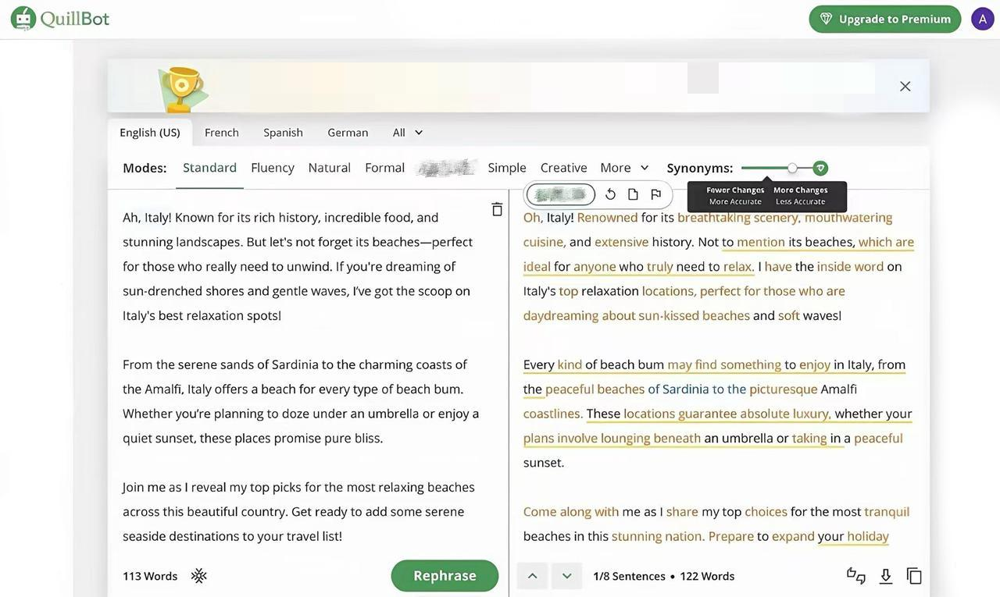

# Essay 预检测 AI 率 88%！实测三款英文降 ai 率工具， AI 率直降5%

上周赶文学方向的课程 Essay，临近截止日期，为了节省时间，我用 **AI 辅助**完成了文献综述初稿。提交前用 **Turnitin** 预检测，结果让我有些慌：**英文 ai 率检测**显示 AI 疑似度达到 88%，不少段落都被标蓝。

现在海外各大高校对**turnitin**AIGC 检测抓得很紧，**AI 率超标**可不是简单修改几句话就能解决。如果遇到 **Turnitin** 检测结果不理想的情况，该如何**优化ai英文文稿**？这篇就结合实际写作场景，聊聊**英文降 ai 率**与 **Humanize AI** 润色的思路。

## 一、为什么 AI 生成的英文稿件，检测结果可能不理想？

不少留学生遇到检测结果不理想时，会反复寻找**英文 aigc 检测免费**平台交叉检查，再通过替换同义词、调整语序来修改文章。但再次进行**英文 ai 率检测**后，结果未必会有明显变化。

原因在于，**AI 检测**并不是简单地统计某些单词出现了多少次。AI 生成的学术英文往往比较规整，句式结构相似，段落衔接流畅，部分表达也容易显得模板化。不过，**这些特征并不能单独证明一篇文章由 AI 生成**，不同检测工具的判断也可能存在差异。

因此，面对 **Turnitin、ZeroGPT、Copyleaks、Originality** 等 **AI Checker** 给出的结果，与其反复替换词汇，不如先检查文章的论证逻辑、段落衔接和语言表达是否自然。

如果需要进行 **Humanize AI** 润色，可以从改善表达、精简重复内容入手，同时保留自己的核心观点、专业术语和文献依据。这样既能提升英文文稿的可读性，也能避免为了追求检测数值而破坏原有的学术逻辑。

## 二、手工降 AI 实操三招，注入真人写作质感

手动润色是最稳妥的办法，核心就是**打破 AI 模板**，增加属于自己的写作痕迹，这三个方法是我多次改稿总结出来的。

1. 拆解刻板长句。不要通篇堆砌厚重学术词汇，遇到连续多层复杂从句，拆分成短句，加上少量自己的补充说明。不要一味追求书面化长难句，模仿平时和同学线上讨论论文的表达节奏，调整断句方式。

2. 加入专属研究细节。这一招在**英文降 ai 率**时效果最好。写文献评述不要只是平铺直叙复述前人结论，可以加入自己阅读文献的思考，比如在读这篇文献时，发现样本选取存在局限，课上和组员讨论过这个缺陷。这类带有个人研究感受的细节，AI 很难凭空编造，能够明显降低 AIGC 痕迹。

3. 调整段落逻辑顺序。**AI 写稿**习惯段落首尾呼应，过渡词固定成套，逻辑过于完美。改写时适当调换句子顺序，删掉冗余模板过渡句。不要反复用翻译软件来回倒文本，很容易出现机翻感，多加入第一人称，把理论描述和自己读文献的体会结合。

## 三、三款改写工具横向测评与避坑指南

纯手动修改效果稳定，但 DDL 扎堆，多篇作业同时赶稿时，逐字打磨非常耗费精力。搭配靠谱的**英文降 ai 率**工具，能省下大量时间。我日常常用的四款工具，说说真实的使用感受。

### 1、笔灵英文降 AI

传送门：[笔灵英文降ai ](https://ibiling.cn/paper-pass/english?from=githubywjiangai1009jw)[https://ibiling\.cn/paper\-pass/english](https://ibiling.cn/paper-pass/english?from=githubywjiangai1009jw)

在专门适配新版**turnitin**的**英文降 ai 率**工具里，笔灵的改写效果是我实测下来最稳定的，**Humanize AI** 的完成度很高。

很多同学改稿翻车，根源就是普通改写工具只会机械替换单词，改完文本生硬、机翻感重。笔灵会按照真人写学术英文的思路重构全文句式，改写后的英文流畅自然，不会破坏论文原本的观点与学术含义，适配 ZeroGPT、Copyleaks、Originality 等多款**AI Checker**。

我最爱的功能就是术语锁定。可以手动锁定论文中的专业名词、实验数据、核心论点和文献引用，改写只会优化模板感重的句子，不会随意改动关键内容，自己的研究观点全部保留，写学术论文的时候更安心。

还有留学生普遍头疼的排版问题，docx、txt 文档支持直接批量上传，原稿段落、表格、脚注注释格式完整保留，改完不用重新调整版式，赶 DDL 的时候真的省心很多。

如果部分顽固段落，做完改写之后，**英文 ai 率检测**结果依旧偏高，还能对接人工包改。就算不太擅长手动润色的新手，也能把数值调整到安全区间。 客观来讲，笔灵改写效果依赖原始文稿质量，如果初稿本身观点混乱，它也无法凭空完善你的研究逻辑。

### 2、EssayBye

EssayBye 在局部精细化改写圈子热度不低，主打语义深度重写，修改幅度可控，适合处理顽固高 AI 段落。我之前有一段文献综述，反复手动修改，**英文 ai 率检测**还是飘蓝。

短板也很突出：偶尔擅自改动专业术语，文本字数限制严格，排版容易错乱，改写完成后需要大量校对工作。适合简单润色普通段落，涉及专业内容，校对成本会很高。

### 3、QuillBot

留学生圈内老牌改写工具，很多人写论文入门都会用，简单润色句子、替换词汇、搭建初稿框架还算好用。

但想用它搞定**turnitin**的 AI 检测，期望值不能太高。 我试过切换各种改写模式，改写后的文本拿去做**英文 ai 率检测**，AIGC 分数经常还是超标。想要靠它应对新版**turnitin**，反复调试参数的时间，足够手动重写段落，适合初稿微调，单纯用来降 AI 痕迹很容易踩坑。

## 四、根据 AI 检测分数，选择对应的修改策略

熟悉各个工具优缺点之后，要结合**英文 ai 率检测**出来的数值调整方案，不能盲目改写。 如果初稿 AI 率＞40%，一次性降到安全区间难度大。可以先用笔灵做全文改写，删掉空洞模板套话，填充自己读文献的研究细节，这一步最考验你对课题的理解。 数值在 20%\-40% 区间，是最好处理的。先用专业**英文降 ai 率**工具处理全文，打散规整句式，之后通读全文，调整别扭语句，基本就能降到安全范围。

## 写在最后

我们花心思去**除文稿 AI 痕迹**，不是投机取巧。大模型只能作为起草辅助工具，一篇顺利通过**turnitin**审核的论文，核心还是你自己的研究思考。 不管手动补充研究细节，还是借助工具减轻改稿压力，目的只是优化行文，让文字更贴近真人写作的质感。句式调整这类繁琐工作交给工具，我们自己牢牢把控论文观点、逻辑和质量，才能安心提交。 希望这份**turnitin**和**英文降 ai 率**的实测分享，帮正在赶 due 的留学生少踩坑，顺利过稿。

